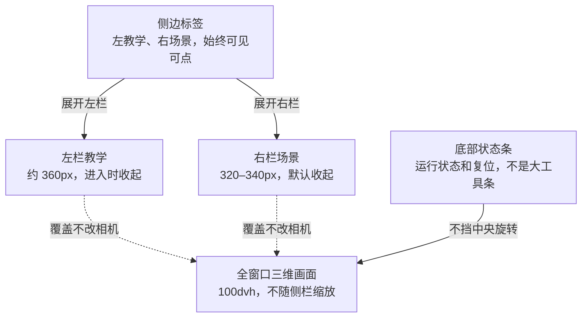
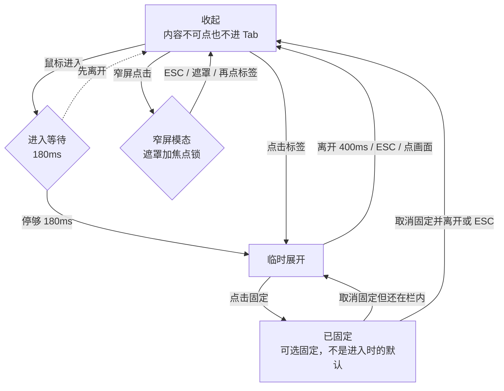

# 亚龙虚仿 · 界面改版计划

- 日期：2026-11-16（香港时间）
- 性质：规划文档，不是实现报告。各步状态均为「已规划，未开始」，没有改项目代码，也不表示任何实现已经完成。
- 来源：从规划 Page《亚龙虚仿 · 界面改版计划》导出的完整正文（含中文设计说明、状态表，以及可直接粘贴给 Codex 的英文任务说明）。
- 参考 Page：https://cursor.com/canvas/store-350f852f-d200-44fa-9e50-8008d86b6de6/5d078585-1d34-4ea0-85ae-6a7d50086dbd
- 建议放入项目后的相对路径：已确认演示目录根下的 `UI-REDESIGN-PLAN.md`，即 `C:\Users\qianchen\Desktop\亚龙虚仿\output\github-pages-20261110-physics-demo\UI-REDESIGN-PLAN.md`

## 目录

1. [本文档是什么](#1-本文档是什么)
2. [设计结论](#2-设计结论)
3. [范围、条件与不做的事](#3-范围条件与不做的事)
4. [页面结构](#4-页面结构)
5. [交互行为](#5-交互行为)
6. [视觉、技术与令牌](#6-视觉技术与令牌)
7. [左右栏放什么](#7-左右栏放什么)
8. [实施步骤总览](#8-实施步骤总览)
9. [共同规则（可粘贴）](#9-共同规则可粘贴)
10. [第 0 步：盘点与存档](#10-第-0-步盘点与存档)
11. [第 1 步：结构壳](#11-第-1-步结构壳)
12. [第 2 步：交互与无障碍](#12-第-2-步交互与无障碍)
13. [第 3 步：玻璃样式](#13-第-3-步玻璃样式)
14. [第 4 步：已有入口与模式回归](#14-第-4-步已有入口与模式回归)
15. [验收、动手点、风险与状态](#15-验收动手点风险与状态)

## 1. 本文档是什么

这是界面改版的专项计划，日期 2026-11-16（香港时间）。它只记载方案、令牌和可粘贴任务说明，不是系统界面样稿，也还没有改任何项目代码。项目整体事实仍以规划总表为准。

默认交给 Codex（gpt-6-astra）按步执行。任务说明是英文，最终报告要用简体中文。导出本文时不启动任何编程 agent，也不使用付费的 omp。

## 2. 设计结论

**三维画面占满窗口，按钮放进左右侧栏，需要时再呼出。**

浏览器窗口里只剩实验箱画面，不出现整页滚动，也不自动请求浏览器全屏。左栏放教学关卡与编辑，右栏放场景、光线和动作演示。侧边始终留着小标签「教学」和「场景」，鼠标移上去会展开，点击或键盘也能打开。进入页面时左右栏都收起，画面直接全屏；左栏不要一进来就固定展开。正在编辑时左栏保持打开，这是临时保护，不是进入时的默认固定。需要时可以再手动固定。视觉借鉴 macOS 的克制、半透明和细腻层次，用材质感做到，不做假的系统窗口，也不按百分比宣称贴近程度。壳子用原生 HTML、CSS、JavaScript；引擎、是否有完整版或轻量版，以第 0 步在已确认目录里的盘点为准，不默认和旧教学目录相同。不换框架、不加依赖、不改已有渲染管线。

## 3. 范围、条件与不做的事

**本轮只改页面结构和交互外观。** 不要把「界面改完」说成「教学闭环已完成」。历史上在教学目录里，验证只检查数字是不是在合法范围里，真正对答案和关卡解锁是另一项已推迟的任务。本轮只改已确认的独立演示目录 `github-pages-20261110-physics-demo`。目录里的入口、脚本、引擎、是否有完整版/轻量版，不得套用旧教学目录的结构，第 0 步当场盘点后才能当现状说。下文凡未在该目录里当场核实的文件名、入口、完整版/轻量版或控件，都只是历史线索，不是已核实的现状。

| 项目 | 说明 |
| --- | --- |
| 已确认的工作目录 | `C:\Users\qianchen\Desktop\亚龙虚仿\output\github-pages-20261110-physics-demo`。这是此前已确认的独立演示目录，也是本轮界面改版的唯一目标。第 0 步在此目录内盘点入口、文件和 git 基线，不要再问该用哪个目录，也不要改去旧教学目录。 |
| 必须与之分开、且本轮不改 | 它的 `-deepseek` 副本；教学源码目录（此次未提供准确路径，不臆造；若为区分而查看，只读不改）；历史教学目录 `github-pages-20261109-teaching`，以及其他同级输出目录。 |
| 入口与完整版/轻量版 | 不得假定与旧教学目录相同。`index.html`、`demo.html`、`lite.html` 只是查找线索；是否存在、如何组织，以第 0 步在已确认目录里的盘点为准。 |
| 历史脚本线索（出自旧教学目录，不视为现状） | `app.js`、`render-mode.js`、`levels.js`、`angle-map.js`、`lesson-panel`、`lesson-runner`、`lesson-screen`、`teaching-runtime.js`。仅供对照，须在 physics-demo 里重新核实。 |
| 视图里的按钮 | 若此目录里仍有「机械臂搬运、云台升起、复位、爆炸拆解」和相机「教学·屏幕与机械臂」，按字面保留，包括「云台升起」；没有的不要添，也不新做双轴云台驱动。以第 0 步盘点为准。 |
| 技术选择 | 原生 HTML、CSS、JavaScript；新文件只允许 `ui-shell.css` 和 `ui-shell.js` |
| 执行方 | Codex gpt-6-astra；导出本文时不启动；不用付费 omp；未经同意不用 Cursor 云端 agent |

本轮明确不做：改 `-deepseek` 副本或教学源码目录、把旧教学目录当成工作目录、从其它目录复制文件进来、自动从完整版切到轻量版、清理 output 里的其它文件夹、判题与解锁、改模型或贴图、加特效或换引擎、推送与发布、删除文件。若此目录里已有完整版失败提示，要原样保留。

顺序上的建议：同意先做界面结构，但必须先完成第 0 步存档。上面那些推迟的事，不要塞进这一轮。

## 4. 页面结构



侧栏浮在画面上，距窗口边缘 12–16px（默认 14px）。打开侧栏时，三维画布和相机都不变。左右栏可以盖住画面两侧，但不要因此把画布挤小。桌面宽度够时，两栏可以同时打开；窄屏或触屏一次只开一栏，并加遮罩。

## 5. 交互行为



| 操作 | 临时展开 | 已固定 | 窄屏模态 |
| --- | --- | --- | --- |
| 指针进入标签或栏内 180ms | 打开 | 保持 | 不适用，只靠点按 |
| 离开连续热区 400ms | 无焦点、无拖动、无下拉时关闭 | 保持 | 不适用 |
| 进入页面 | 两边都从收起开始，只留标签 | 不使用。进入时不固定 | 两边都收起 |
| 点击侧边标签 | 关闭（编辑中有焦点则保持） | 取消固定；还在栏内或正在编辑则退回临时展开，否则关闭 | 打开或关闭该栏，同时只开一个 |
| 栏内可选的固定按钮 | 变为已固定 | 保持已固定 | 可用，但不改变进入时先收起 |
| ESC | 关闭，焦点回标签 | 取消固定并关闭，焦点回标签 | 关闭，焦点回标签 |
| 点三维画面 | 关闭，不阻止旋转 | 保持 | 点遮罩关闭；遮罩下不能旋转 |
| 栏内输入、焦点、滑块、原生下拉 | 保持打开 | 保持 | 保持 |
| 收起时栏内按钮 | 不可点、不进 Tab | — | 隐藏的一栏同样锁住 |

进入页面时左右栏都收起，只留侧边标签，画面直接全屏。左栏靠悬停或点击打开；正在编辑（栏内有焦点、正在输入、拖动滑块、或打开了原生下拉）时保持打开，这是临时保护，不是进入时的默认固定。需要长时间对着看时，再用可选的固定。桌面响应的条件是：细指针、支持悬停，且窗口宽度不低于 1100px。这时不做焦点锁，两栏可以同时打开。其它情况走窄屏模态：只靠点按标签，不依赖悬停。标签和侧栏要连成一块热区，避免鼠标移过去时被当成离开。

不要给整页套上 `pointer-events:none`，把鼠标事件全部关掉。侧栏上的点击不得带动模型旋转；露出来的画布仍可以拖动。点画布关闭临时侧栏时，同一次拖动仍允许旋转。侧栏收起时，正在执行等关键状态要留在底部状态条里；复位一直可用，但不要把所有动作按钮都做成常驻工具条。

## 6. 视觉、技术与令牌

用原生 HTML、CSS、JavaScript 做壳子和交互，不引入 React、Vue 或新的样式库。毛玻璃效果只加在侧栏、侧边标签和底部状态条上，不要整屏模糊。若第 0 步确认存在轻量版，则关掉模糊或只保留很弱的一档，并把背景加得更不透明一些；不要为了执行本计划去新建一个轻量版。浏览器不支持模糊时，退回成更实的半透明底。动画只用位移和透明度；系统要求减少动效时，展开与收起瞬间完成，但 180ms 和 400ms 的等待仍保留，因为它们是为了减少误触。

| 令牌 | 默认值 | 用途 |
| --- | --- | --- |
| `--ui-inset` | `14px` | 侧栏距边距，允许 12–16px，这是交给你手改的那一项 |
| `--ui-drawer-left-width` | `360px` | 左栏宽度 |
| `--ui-drawer-right-width` | `332px` | 右栏宽度，落在 320–340px |
| `--ui-radius` | `16px` | 侧栏圆角 |
| `--ui-glass-bg` | `rgba(246, 247, 249, 0.62)` | 中性浅色玻璃底 |
| `--ui-glass-bg-strong` | `rgba(246, 247, 249, 0.82)` | 文字区块底，保证亮画面和暗画面都能读 |
| `--ui-blur` | `20px` | 仅完整版侧栏模糊（若存在完整版路径） |
| `--ui-blur-lite` | `0px` | 轻量版不做模糊（仅当第 0 步确认存在轻量版时使用） |
| `--ui-accent` | `#0A84FF` | 选中与强调，蓝色 |
| `--ui-font` | 系统字体队列 | 先走系统字体，Windows 退回 Segoe UI 与微软雅黑 UI |
| `--ui-move` / `--ui-ease` | `180ms`、缓出曲线 | 只用于位移和透明度 |

字体大小建议：正文约 13px，栏目约 15px，说明文字约 11px。阴影和边线要轻，足够把侧栏从画面里打起来，不要厚重。

第 3 步任务说明里还包含这些配套令牌，一并执行：`--ui-radius-sm: 10px`、`--ui-pad: 14px 16px`、`--ui-glass-border: rgba(255, 255, 255, 0.55)`、`--ui-glass-edge: rgba(40, 42, 48, 0.12)`、`--ui-glass-shadow: 0 8px 28px rgba(20, 22, 28, 0.16), inset 0 1px 0 rgba(255,255,255,0.45)`、`--ui-saturate: 1.15`、`--ui-text: rgba(22, 24, 28, 0.92)`、`--ui-text-secondary: rgba(22, 24, 28, 0.62)`、`--ui-accent-soft: rgba(10, 132, 255, 0.14)`、`--ui-move: 180ms`、`--ui-ease: cubic-bezier(0.22, 1, 0.36, 1)`。字体队列为：`-apple-system, BlinkMacSystemFont, "Segoe UI", "Microsoft YaHei UI", "Microsoft YaHei", "PingFang SC", "Noto Sans SC", sans-serif`。

## 7. 左右栏放什么

| 分区 | 说明 |
| --- | --- |
| 左栏·教学 | 该目录里实际已有的关卡、任务目标、说明、参数编辑、填写、验证、执行，都按当前实际有的来。旧教学目录历史上是 7 关，是否在本目录存在要第 0 步确认。不新增判题或解锁，也不从教学目录把界面复制过来。 |
| 右栏·场景 | 按第 0 步盘到的实际控件分组。若仍有「机械臂搬运、云台升起、复位、爆炸拆解」和相机「教学·屏幕与机械臂」，按字面保留；没有的不要添。已有的环境和光线参数、完整版/轻量版切换（若存在）、调试或材料工作台放进折叠的「高级」。 |
| 复位 | 只恢复机械臂姿态和正在播的动作，不清教学填写，也不清侧栏是否固定。 |
| 互锁 | 能用已有约束就保留；没有就加最小防护，避免关卡执行和动作演示同时开跑。不重做运行时逻辑。 |

搬迁时要保留原按钮和原函数，不要新做一套再绑一次，避免点一下触发两次。当前没有的灯光或调试选项，不要编造绑定。

## 8. 实施步骤总览

必须按 0 → 1 → 2 → 3 → 4 的顺序。上一步验收通过后，才贴下一步。每执行一步，先粘「共同规则」，再粘当前那一步的说明。

1. **第 0 步：盘点并存档。** 只在已确认的 `github-pages-20261110-physics-demo` 目录里查清未提交的改动，逐个选文件存档，不要盲目 `git add .`，不要删文件或再复制一份文件夹来「整理」。不要改去其它目录。存档用本地提交和标签 `pre-ui-shell-20261116`。没有这个回退点，不要进第 1 步。
2. **第 1 步：搭结构壳。** 全窗口画面加左右栏，搬迁现有控件并保留原函数。这一步不做完整的展开动作，也不打磨玻璃样式。
3. **第 2 步：交互与无障碍。** 按上表实现展开、固定、键盘和窄屏模态。后面会当场看：上课编辑时要不要把左栏固定住，而不是去改进入时先收起的设计。
4. **第 3 步：玻璃样式。** 落实令牌，若存在轻量版则减弱模糊。可以后来只改 `--ui-inset`（12–16px）并刷新看边距，这不阻挡本步完工。
5. **第 4 步：回归。** 在第 0 步确认存在的每个入口和模式下测试，并做约定尺寸的画面检查。不要臆造未找到的完整版或轻量版。

每一步的报告都要写：实际改了哪些文件、差异摘要、真正跑过的测试、若已有截图手段则附截图、本地提交记录、以及什么还没核实。不要推送、不要发布。

## 9. 共同规则（可粘贴）

每执行一步，先粘下边这段，再粘当前那一步的说明。

```
Yalong virtual-simulation UI redesign — STANDING RULES (paste with every phase).

You are Codex (gpt-6-astra). Work only in the confirmed standalone demo directory named below. Do only the current phase. After finishing, write the final report in Simplified Chinese and STOP for human review. Do not start the next phase.

WORKTREE
- Confirmed standalone demo directory (Windows), and the ONLY worktree for this UI task: C:\Users\qianchen\Desktop\亚龙虚仿\output\github-pages-20261110-physics-demo
- Do not ask the user to reconfirm this directory. Do not switch to another folder. Do not create a new copy to work in.
- Do not modify the sibling -deepseek copy of this demo. Do not modify the teaching source directory (its exact path is not supplied here; do not invent it). If you must tell a nearby folder apart from this one, you may read it only; never edit it, and never copy files from it into the worktree. Do not modify historical github-pages-20261109-teaching, github-pages-20261031, or other sibling output folders.
- Historical note only, NOT the current target: an earlier plan used output\github-pages-20261109-teaching. File names and a full WebGPU / lite WebGL dual-build layout in older notes came from that teaching tree. Do not assume this physics-demo directory has the same engine, the same entry files, or the same full/lite split.
- Discover the actual entrypoints, scripts, git baseline, and whether a full and lite mode exist by inspecting this confirmed directory in Phase 0. Names such as index.html, demo.html, and lite.html are search hints only, not a claim that they exist here. Older teaching-tree clues such as app.js, render-mode.js, levels.js, angle-map.js, lesson-panel, lesson-runner, lesson-screen, and teaching-runtime.js are historical; treat them as current only if you find them in this directory.

HARD CONSTRAINTS
1. UI-structure task only: full browser-viewport Three.js view and left/right hidden glass drawers. No engine or post-process change, no new framework or npm dependency, no WebGPU auto-fallback, no lesson-data edits, no answer grading or level unlocks, no GLB/model/texture edits, no render-pipeline changes, no delete/copy folder cleanup, no git push, no GitHub Pages publish, no remote tags.
2. Keep the engine, render path, and any full/lite (or equivalent) modes actually present in this directory. Do not assume they match the historical teaching folder. If a WebGPU error UX already exists here, preserve it exactly; do not add a new automatic switch to lite. Do not change the render pipeline.
3. Do not invent control bindings. If a camera, light, environment, debug, or workbench control is not already present, list it as absent and leave it out.
4. Do not call a path, handler, or behavior “current” unless you opened the file or ran the check in this phase.
5. Never run git add . Stage named paths only. Do not rewrite history. Do not force-reset unless a later human review asks.
6. Preserve existing actual functionality and exact labels found in this directory. If these labels exist, keep them exactly: 机械臂搬运, 云台升起, 复位, 爆炸拆解, and camera option 教学·屏幕与机械臂. If a label is absent, list it as absent; do not add it. If 云台升起 is already present, keep it even though an older product decision deferred new gimbal work; do not add new gimbal axes.
7. Reset means machine pose / running action, not lesson answers, UI pin preferences, or render settings.
8. If blocked, stop and report. Do not expand scope to get unstuck.
9. Initial load: BOTH drawers start collapsed (not pinned, not open). Only the persistent 教学 / 场景 labels are visible, so the scene is directly fullscreen. Do not pin or open the left drawer on load. The left drawer opens on hover or click. Staying open while the user is actively editing (focus, typing, slider drag, or an open native select) is transient protection, not a default pin. Pin is optional and user-initiated.

REPORT FIELDS (required, Simplified Chinese)
Actual path used; files you changed; diff summary; tests you actually ran; screenshots if a capture method already exists (do not add a dependency to take them); commit/tag if any; everything unverified.
```

## 10. 第 0 步：盘点与存档

只在已确认的 `github-pages-20261110-physics-demo` 目录里做盘点和安全存档，不开始改界面，也不要改去其它目录。存档用本地提交和标签 `pre-ui-shell-20261116`。没有这个回退点，不要进第 1 步。

```
Yalong virtual-simulation UI redesign — Phase 0 of 4: inventory and safe baseline archive.

Apply the Standing Rules in full (pasted with this prompt).

GOAL
In the confirmed directory github-pages-20261110-physics-demo only, create a local rollback point for the pre-redesign state, and an evidence-based inventory that later phases must follow. Do not start any UI markup, drawer, or style work. Do not ask the user to reconfirm the directory or to switch to the historical teaching folder.

STEPS
1. Work in the confirmed physics-demo directory. Record machine, OS, cwd, and git user of this worktree. Run git status, git log -5 --oneline, git remote -v, and git diff --stat. List every dirty and untracked path, grouped as: existing unpublished work in this demo; unrelated files; generated or build artifacts; secrets or large binaries. Uncommitted work does not mean “no rollback is possible.” State what rollback still exists (prior commits, stash, a new baseline commit).
2. Do not delete files. Do not copy the tree to make a “clean” folder.
3. Propose and, if the set is clear, create a baseline archive of the current pre-UI-redesign state in this confirmed directory. Stage only files that belong to this standalone demo, path by path. Leave unrelated files unstaged and explain why. Commit locally with a message like: “archive: physics-demo baseline before UI shell redesign 2026-11-16”. Create a local annotated tag pre-ui-shell-20261116 on that commit. Do not push the commit or the tag.
4. If you cannot commit safely (no git, missing identity, or mixed/unreadable dirties), do not force it. Stop after the inventory, describe the risk, and give the exact staging plan for human review. A missing baseline is a blocker for Phase 1.
5. Inventory this confirmed directory by reading files, and by briefly opening the local demo only if a start method already exists. Do not assume the engine, file topology, or a full/lite split matches the historical teaching folder:
   - Live HTML entries, the actual engine/render path, and whether a full vs lite (or equivalent) mode exists and how it is chosen. If a mode is absent, say so; do not invent it.
   - CSS/JS graph and where current UI markup lives.
   - Exact existing controls: visible label, element id, and handler function name. If 机械臂搬运, 云台升起, 复位, 爆炸拆解, or camera 教学·屏幕与机械臂 are present, record them; also list any others you find. If one is absent, list it as absent.
   - Lesson UI, if any: level list, goal, instructions, parameter editor, fill, verify, execute. The historical teaching tree had seven levels and range-check-only verify; confirm or correct what exists HERE with file evidence. Do not add grading, unlocks, or lesson UI copied from another directory.
   - Cameras, environment, lights, full/lite switch, debug or material workbench: list only what exists.
   - Pointer/camera orbit path, canvas event binding, and any command interlocks between lesson execution and action demos, if those features exist.
   - Existing WebGPU failure UX, if any.
   - Anything that resizes the renderer or moves the camera when layout changes.
6. You may write ui-shell-inventory.md at the worktree root for later phases. No other feature work.

ACCEPTANCE
- A local baseline commit and tag exist, OR the report clearly blocks later phases with a file-by-file staging plan.
- Inventory names live entries, the actual engine/modes (including whether full and lite exist), labels, ids, handlers, interlocks, verify behavior if any, and WebGPU error UX if any, each with a file path.
- No UI redesign, no new dependency, no push, no deleted trees.

ROLLBACK
This phase creates the rollback point. If a local commit is wrong, say so and stop; do not force-reset.

REPORT in Simplified Chinese with every required field, then stop.
```

## 11. 第 1 步：结构壳

在现有画面外套上左右栏，搬迁已有控件，保留原函数。这一步不做完整的展开动作，也不打磨玻璃样式。

```
Yalong virtual-simulation UI redesign — Phase 1 of 4: structural shell, existing controls, handler identity.

Apply the Standing Rules in full. Start only after Phase 0 was accepted and the baseline tag exists. Do not implement the full dwell/grace/modal interaction system (Phase 2) and do not polish glass styling (Phase 3).

GOAL
Build a full-viewport shell around the existing Three.js view and relocate existing controls into a left teaching drawer and a right scene drawer, without breaking handlers or resizing the renderer when drawers open.

LAYOUT (implement these numbers)
- The simulation fills the browser viewport: html/body/shell/canvas use 100dvh (or the existing visual-viewport equivalent), overflow hidden, no page scroll.
- Do NOT call requestFullscreen or any Fullscreen API.
- Drawers are floating overlays, inset by --ui-inset: 14px (allowed range 12-16px). Left width 360px, right width 332px.
- Opening or closing a drawer must not resize the canvas, must not call renderer.setSize except on the existing window-resize path, and must not reposition the camera.
- Persistent small edge labels, always visible, text exactly 教学 (left) and 场景 (right). They must be real buttons (not hover-only divs), so Phase 2 can hook click and keyboard.
- After load, BOTH drawers start collapsed (not pinned, not open). Only the persistent 教学 and 场景 labels are visible, so the scene is directly fullscreen. Do not open or pin the left drawer on initial load.
- A restrained bottom status strip: current lesson or run state if that information already exists, plus an accessible 复位 control that calls the SAME reset handler as the right-drawer 复位. Not a second toolbar of all actions.

STRUCTURE RULES
- New vanilla files are allowed: ui-shell.css and ui-shell.js only, plus the smallest HTML hooks in the live entry pages. No frameworks, no new dependencies.
- Apply the shell to every live entry Phase 0 identified in this confirmed directory, including a full or lite entry only if that entry actually exists. Share code when the entries already share markup; do not leave one live entry on the old chrome. Do not copy UI or lesson files from the teaching source, the -deepseek copy, or github-pages-20261109-teaching.
- MOVE existing control nodes (or wrap them in place). Do not recreate buttons that would double-fire. Ids and handler function references must stay the same. If a listener must be rebound, it must call the original function, not a copy of its body.
- Left drawer contains the existing lesson UI as it actually exists in this directory: levels, goal, instructions, parameter editing, fill, verify, execute, or whatever subset is present. Do not add grading, unlocks, or new lesson fields, and do not import missing lesson UI from the historical teaching folder. Do not describe verify as complete grading.
- Right drawer groups the controls Phase 0 actually found, in this order when present: (1) action buttons 机械臂搬运, 云台升起, 复位, 爆炸拆解; (2) existing camera select, including 教学·屏幕与机械臂 if it exists; (3) existing environment/light parameters; (4) a full/lite switch only if present; (5) debug or material workbench under a collapsed Advanced section only if already present. Omit any group that does not exist.
- Interlocks: keep any existing ones found in Phase 0. If none exist, add the smallest guard so a lesson execute and an action demo cannot start together (disable the other group while one run is active; re-enable on the existing complete/reset path). Do not redesign the runtime.
- Temporary panel background may be a plain readable surface. Do not spend this phase on glass, blur, or typography polish.
- Do not use a full-screen pointer-events:none overlay. The canvas must still receive events in uncovered areas.

ACCEPTANCE
- Every live entry identified in Phase 0 shows the shell: 100dvh, no page scroll, no Fullscreen API.
- After load, both drawers are collapsed, both edge labels are visible, and the scene is fullscreen with no drawer covering it.
- Every pre-existing control listed in the Phase 0 inventory is present once, same handler identity, and still works in a smoke test of the features that actually exist (for example, if present: select a level, fill, verify, execute; run 机械臂搬运, 云台升起, 复位, 爆炸拆解; switch camera to 教学·屏幕与机械臂; existing light/env/full-lite/debug).
- Opening a drawer does not change canvas size or camera.
- Local commit only, no push, message like “ui-shell: structural overlay drawers, preserve handlers”.

PROHIBITIONS
No Phase 2 state machine completeness requirement beyond a simple pinned/collapsed class; no glass polish; no grading; no render/GLB edits; no new deps; no push.

ROLLBACK
git reset --keep pre-ui-shell-20261116 (or revert the Phase 1 commit) is enough. Do not delete files to roll back.

REPORT in Simplified Chinese with every required field, then stop.
```

## 12. 第 2 步：交互与无障碍

落实展开、固定、键盘和窄屏模态。你后面会当场看：上课编辑时要不要把左栏固定住，而不是去改进入时先收起的设计。这不影响这一步交付。

```
Yalong virtual-simulation UI redesign — Phase 2 of 4: drawer interaction and accessibility.

Apply the Standing Rules in full. Start only after Phase 1 was accepted. Do not restyle the glass look (Phase 3) except for a visible focus ring and any class hooks you need.

GOAL
Implement the agreed drawer behavior so teaching and scene controls can stay hidden, then be opened reliably with pointer, touch, and keyboard, without stealing the 3D view or trapping desktop keyboard focus.

DESKTOP MODE
Use desktop hover behavior only when all of these are true: (hover: hover) and (pointer: fine) and viewport width >= 1100px. In this mode both drawers may be open at once.

Each drawer has three states: collapsed, open (temporary), pinned.
- Edge label + panel form one contiguous hit zone. Moving from label to panel must not count as a leave.
- Pointer enters the hit zone: after a 180ms dwell, open as temporary if it was collapsed. Cancel the dwell if the pointer leaves first.
- Pointer leaves the hit zone: after a 400ms grace, close if the drawer is temporary AND there is no focus inside AND no active slider drag AND no open native select. Pinned drawers never auto-close.
- Clicking the edge label toggles collapsed and temporary-open. It must NOT pin. Pinning is a separate, optional control in the drawer. If the drawer is already pinned, a label click unpins (stay temporary-open if the pointer is still inside or editing protection applies, otherwise close).
- Escape: close the drawer that contains focus, or if focus is outside, close a temporary drawer first (right before left), then a pinned one. Unpin if it was pinned. Restore focus to that drawer’s edge label.
- Pointer down on the canvas (outside drawers and labels): close temporary drawers; leave pinned drawers open. Do not block orbit/pan on that same gesture.
- Stay open while the user is typing, focusing a control, dragging a slider, or while a native select list is open.
- Initial load: both drawers collapsed, labels visible, scene fullscreen. The left drawer opens on hover or click. While the user is actively editing in a drawer (focus, typing, slider drag, or an open native select), that drawer stays open even if unpinned. This is transient protection, not a default pin. After editing ends and the 400ms grace expires, an unpinned drawer may auto-hide. An optional pin is available if the user wants a drawer to stay open after leaving the panel or clicking the canvas.
- Desktop: NO focus trap. When a drawer is collapsed, its contents are inert (and not in the tab order). Opening by keyboard from the label may move focus into the panel; opening by pointer should not steal focus. On close, restore focus to the label if focus was inside.
- Labels are buttons with accessible names 教学 / 场景, aria-expanded, and aria-controls. Visible keyboard focus ring required.

COMPACT MODE (narrow width or no fine hover)
- No hover-open. Labels are click/tap only.
- Only one drawer may be open. It is modal: backdrop, focus trap, Escape / backdrop click / label click closes it, then restore focus to the label.
- Hidden drawer contents stay inert.

OTHER BEHAVIOR
- Animate with transform and opacity only. Respect prefers-reduced-motion: instant open/close, but keep dwell/grace (those prevent accidents, they are not decoration).
- Never use a full-viewport pointer-events:none overlay. UI chrome stops propagation so starting a pointer on a drawer does not rotate the model. The uncovered canvas remains usable.
- When collapsed, critical run state must remain discoverable in the restrained bottom status (for example: executing, or a short failure text if that text already exists). 复位 stays available in the status strip via the original handler. Do not build a large always-on toolbar.
- If the user pins a drawer during the session, that pin may be remembered in memory until reload; do not invent a large preferences system. A fresh load must still start with both drawers collapsed.

ACCEPTANCE (manual + keyboard)
- Desktop widths 1280x800, 1440x900, 1920x1080: hover, dwell, grace, pin/unpin, Escape, canvas click, both drawers open together, canvas still orbits, inputs/sliders/select do not auto-close the left drawer.
- 768-wide and 390x844: click-only, one modal drawer, focus trap, backdrop, Escape restores focus, no hover requirement.
- Tab never reaches collapsed contents. Screen-reader or accessibility-tree check if a tool already exists; otherwise report unverified.
- Lesson editing can proceed with the left drawer staying open under transient editing protection (no auto-collapse while input, focus, a slider, or a native select is active). Pin remains optional and is not applied on load.
- Local commit only, no push.

USER HANDS-ON (do not block this phase on it)
Keep both drawers collapsed on load; do not change that hidden-on-load default. The user will later judge whether to pin the left drawer during a lesson, not whether to override hidden-on-load. Document in the report how to pin and unpin during a lesson.

ROLLBACK
Revert this phase’s commit, or reset --keep to the Phase 1 commit / pre-ui-shell-20261116.

REPORT in Simplified Chinese with every required field, then stop.
```

## 13. 第 3 步：玻璃样式

落实令牌与毛玻璃。你可以后来只改 `--ui-inset`（12–16px）并刷新看边距，这不阻挡本步完工。

```
Yalong virtual-simulation UI redesign — Phase 3 of 4: glass style and design tokens.

Apply the Standing Rules in full. Start only after Phase 2 was accepted. Do not change interaction logic except for style hooks. Do not change the 3D scene, materials, or render path.

GOAL
Apply a restrained, macOS-inspired glass look through materials: frosted panels, hairline borders, soft shadow, system typography, blue accent. Do not fake an operating system. No Apple logo, no traffic-light window buttons, no menu bar, no dock. Do not claim “90% macOS” or any measured fidelity in comments or UI copy.

IMPLEMENT THESE TOKENS in ui-shell.css (:root), with a short comment that --ui-inset is the official user-adjustable token:
--ui-inset: 14px;            /* official hands-on token, allowed 12-16px */
--ui-drawer-left-width: 360px;
--ui-drawer-right-width: 332px;
--ui-radius: 16px;
--ui-radius-sm: 10px;
--ui-pad: 14px 16px;
--ui-glass-bg: rgba(246, 247, 249, 0.62);
--ui-glass-bg-strong: rgba(246, 247, 249, 0.82); /* behind text-heavy blocks */
--ui-glass-border: rgba(255, 255, 255, 0.55);
--ui-glass-edge: rgba(40, 42, 48, 0.12);
--ui-glass-shadow: 0 8px 28px rgba(20, 22, 28, 0.16), inset 0 1px 0 rgba(255,255,255,0.45);
--ui-blur: 20px;
--ui-blur-lite: 0px;
--ui-saturate: 1.15;
--ui-text: rgba(22, 24, 28, 0.92);
--ui-text-secondary: rgba(22, 24, 28, 0.62);
--ui-accent: #0A84FF;
--ui-accent-soft: rgba(10, 132, 255, 0.14);
--ui-font: -apple-system, BlinkMacSystemFont, “Segoe UI”, “Microsoft YaHei UI”, “Microsoft YaHei”, “PingFang SC”, “Noto Sans SC”, sans-serif;
--ui-move: 180ms;
--ui-ease: cubic-bezier(0.22, 1, 0.36, 1);

STYLE RULES
- Neutral light glass, dark text, so type stays readable on both bright studio and darker scenes. If contrast fails over the default camera 教学·屏幕与机械臂, raise --ui-glass-bg-strong, do not switch to a dark inverse theme in this phase unless contrast is still impossible.
- backdrop-filter: blur(var(--ui-blur)) saturate(var(--ui-saturate)) only on the drawer surfaces, edge labels, and the small status strip. No full-screen blur, no animating blur.
- If a lite build exists, use --ui-blur-lite (0px) and a higher opacity background. Do not pay for blur on the lite path. If no lite build exists, apply the full-path glass only to the entries that do exist; do not create a lite build.
- @supports fallback when backdrop-filter is missing: no blur, use the stronger background.
- Motion: transform and opacity only. prefers-reduced-motion: instantaneous show/hide.
- Type: body about 13px, titles about 15px, captions about 11px, comfortable line-height. Windows must fall back cleanly to Segoe UI / Microsoft YaHei UI.
- Edge labels stay small and persistent. A very small pinned indicator is allowed; keep it quiet.
- Buttons and fields inherit the glass; selected/accent states use --ui-accent, not a rainbow of colors.

USER HANDS-ON (do not block this phase on it)
Document at the token block that the user may change --ui-inset between 12px and 16px and reload. Do not require them to edit anything for you to finish.

ACCEPTANCE
- Live entries show limited-area glass. If a lite build exists, it has weaker or no blur. A no-backdrop-filter fallback path exists.
- Type is readable at the default camera and, if an alternate environment already exists, at one darker or brighter setting.
- No OS-chrome imitation. No new animation besides transform/opacity.
- Interaction from Phase 2 still works. Local commit only, no push.

ROLLBACK
Revert this phase’s commit.

REPORT in Simplified Chinese with every required field, then stop.
```

## 14. 第 4 步：已有入口与模式回归

测试尺寸：1280×800、1440×900、1920×1080、768 宽、390×844。只测第 0 步确认存在的入口和模式。性能要在同一台电脑、同一默认或已有的「教学·屏幕与机械臂」相机、同一套光线和姿态下，跟存档基线比较帧率。持续低过 10% 只是调查门槛，不是性能承诺；只查界面引起的浪费，不要改渲染管线。

```
Yalong virtual-simulation UI redesign — Phase 4 of 4: regression of every live entry and mode identified in Phase 0.

Apply the Standing Rules in full. Start only after Phase 3 was accepted. Fix only defects caused by the UI shell (event conflicts, inert mistakes, contrast, accidental renderer resize, UI-caused waste such as a full-screen blur). Do not retune scene lighting, strip post-processing, edit GLB, or add WebGPU auto-fallback to chase results.

GOAL
Prove that every live entry and mode identified in Phase 0 still works as it did before the shell, at the agreed viewports, and record performance honestly. If both a full and a lite mode exist, test both. Do not invent a mode that Phase 0 did not find. Do not assume the engine or dual-mode layout matches the historical teaching folder.

TESTS (every live entry and mode Phase 0 identified; skip any test whose feature or mode was not found)
1. Viewports: 1280x800, 1440x900, 1920x1080, 768-wide, 390x844. On first load at every viewport, both drawers are collapsed and only the edge labels are visible, so the scene is directly fullscreen. At desktop sizes both drawers may later be open together and must overlay without resizing the renderer or moving the camera. At 768 and 390, only the compact modal behavior is used. While filling or editing parameters, the left drawer must not auto-collapse; pin is optional and must not be applied automatically on load.
2. Lesson smoke, only if lesson UI exists in this directory: open each existing level, read goal/instructions, use the parameter editor, fill, verify, execute. The historical teaching tree had seven levels and range-check-only verify; follow what Phase 0 documented HERE. Do not add grading and do not report grading as newly complete.
3. Actions and camera, only if present: 机械臂搬运, 云台升起, 复位, 爆炸拆解, and camera 教学·屏幕与机械臂. Exercise existing env/light and a full/lite switch only if present. If a reset control exists, confirm it restores machine pose and does not clear lesson inputs or pin preference unless that was already old behavior (if it does, report it; do not “fix” by expanding reset scope).
4. Interlocks: lesson execute and action demos do not run over each other, per Phase 1 rules.
5. Pointer: starting a drag on the canvas still orbits/pans; starting a pointer on a drawer does not rotate the model.
6. Keyboard and compact checks from Phase 2 still pass on at least one desktop size and on 390x844.
7. WebGPU error UX, only if this directory already has one: preserve the existing path. If you can trigger the existing failure condition, confirm the same UI still appears. If there is no such UX, say so. If you cannot trigger it, mark this unverified and write how you tried. Do not add auto-fallback.
8. Performance: same device, same camera (use 教学·屏幕与机械臂 if it exists, otherwise the directory’s default camera), same environment/light settings, same pose. Compare FPS against the pre-ui-shell-20261116 baseline (check out the tag in a way that does not destroy later commits; or use a worktree / temporary checkout). Sample several seconds, not a single frame. A sustained drop of more than 10% is an investigation threshold, not a performance promise: look for UI-caused waste only. If you cannot restore the baseline tag, say unverified and still report absolute FPS now.
9. Screenshots if a capture method already exists (for example Playwright already in the project). Do not add a new dependency just to take pictures. If you cannot capture, say so.

ACCEPTANCE
- All smoke tests actually run are listed, with pass/fail and the viewport/build used.
- No unresolved interaction bug that blocks the features Phase 0 actually found.
- Honest performance notes; no renderer rewrite.
- Local commit only if fixes landed; no push.

ROLLBACK
Revert Phase 4 fixes, or reset --keep to the accepted Phase 3 commit, or to pre-ui-shell-20261116 for a full unwind.

REPORT in Simplified Chinese with every required field, including baseline vs current FPS and any item left unverified, then stop. This is the last phase; do not propose extra visual or teaching-logic work inside the same report as if it were already in scope.
```

## 15. 验收、动手点、风险与状态

你这一轮共有两处动手点，都不阻挡设计定案：一是上课编辑时体验要不要把左栏固定住（进入时仍默认两边收起）；二是按说明改 `--ui-inset`（12–16px）看边距。

阶段状态（截止 2026-11-16，香港时间；均为已规划，未开始，不是已经完成）：

- [ ] 第 0 步：盘点与存档
- [ ] 第 1 步：结构壳
- [ ] 第 2 步：交互与无障碍
- [ ] 第 3 步：玻璃样式
- [ ] 第 4 步：已有入口与模式回归

风险与注意：

1. 进入时画面是全屏的；侧栏打开后仍可能挡到默认相机「教学·屏幕与机械臂」里的设备屏幕和机械臂。画布不缩放是硬要求，但覆盖仍会发生；若严重，以后只能调侧栏宽度或边距，不能改相机去迁就侧栏。
2. 毛玻璃会占性能。若存在较重的完整版，模糊面积要严格限制；若存在轻量版，则不做模糊。持续低 10% 只调查，不作承诺。
3. 搬迁控件时，最大的实践风险是复制按钮导致双重触发。第 1 步必须保留函数身份。
4. 未提交的旧改动要先看清再存档。没提交不等于无法回退，但存档做得不清，后面就会有事。
5. 浅色玻璃在白面板或暗工作室背景上都可能对比不够，第 3 步要实拍检查，必要时加厚文字区背景。
6. 触控笔记本可能同时带细指针和触摸，要按能否稳定悬停来分流，不要只看屏幕宽度。
7. 工作目录已经确认，不要改去旧教学目录或 `-deepseek` 副本；目录内部的文件结构以第 0 步盘点为准，不套用旧教学目录。没有图纸时仍不保证几何尺寸与实物一致。文件大小要区分十进制 MB 与 MiB，不要把单位差异写成报告造假。

相关 Page：

- 亚龙虚仿 · 规划总表：https://cursor.com/canvas/store-350f852f-d200-44fa-9e50-8008d86b6de6/43dba255-1941-4160-901e-797f04525b93
- 亚龙虚仿 · 技术地图：https://cursor.com/canvas/store-350f852f-d200-44fa-9e50-8008d86b6de6/09655a49-fa1a-42ea-9355-dea50750d42b
